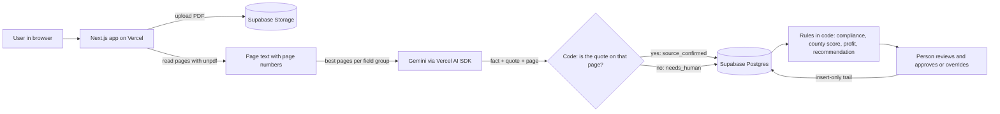

# BidLens Tenders

**Your AI Procurement Companion.** BidLens reads a tender document, shows every fact it finds with the exact quote and page it came from, checks the tender against your company's records, and helps a person decide whether to bid. Nothing is ever submitted for you.

Built by **Tech Nova** for the **TechAI Path Hackathon 2026**, Zanari Analytics **Challenge 2B: Tender Intelligence & Bid Readiness**. Zanari Analytics is the customer workspace shown in the app. It is not the product brand.

## Live demo

**https://bidlens-omega.vercel.app**

It opens straight to the Overview. There is no login.

**How to try it**

1. Open **Tenders** in the sidebar and pick the **Makueni CRMIS** tender.
2. Walk the five stages in order: Interpretation, Compliance, Commercial, Recommendation, Bid preparation.
3. On Interpretation, click a finding's evidence chip to see the quote and the page it was found on.
4. On Commercial, read the county payment-risk card and the delay table.
5. On Recommendation, read why the label was chosen, then open the Bid preparation plan and its download.

**Please look, but do not approve, save, upload or delete.** The public demo shares one database, so changes made by one visitor are seen by everyone.

## The problem

A public tender can run to hundreds of pages. The facts that decide whether a company can bid (the closing date, the bid security, the mandatory documents, how bids are scored) are scattered through it. A missed bond or a missed deadline means a wasted bid. On top of that, many Kenyan county governments carry large unpaid supplier bills, so a bid that wins can still lose money while the supplier waits to be paid.

BidLens turns that reading and checking into one traceable workspace, and leaves the decision with a person.

## What it does

Each tender goes through five stages. A person reviews each one.

| Stage | Question | What happens |
|---|---|---|
| **1. Interpretation** | Can we bid? | The AI extracts key facts from the tender PDF. Each fact carries a quote, a page and a status. Code then checks that the quote really appears on the cited page. Addendum changes and conflicts between documents are flagged. |
| **2. Compliance** | Can we comply? | Deterministic rules match each requirement to the company profile and the evidence library. Results are grouped as met, gaps (including items that could disqualify the bid) and to prepare (forms to fill and sign). |
| **3. Commercial** | Should we bid? | Shows the county's payment-risk score and band from Controller of Budget data, and a profit table that shows the effect of late payment (see [The maths](#the-maths)). |
| **4. Recommendation** | What do we do? | Rules choose one label: Consider declining, Resolve blockers, Seek clarification, or Proceed to preparation. A person approves it or overrides it with a reason. |
| **5. Bid preparation** | How do we proceed? | Builds an action plan from the extracted facts: documents to get, questions to ask the buyer, a response outline in evaluation order, and key dates. Owners, due dates and done ticks are saved. The plan can be downloaded. |

Other pages:

- **Overview**: uploaded tenders, open decisions and recent reviews.
- **Tenders**: the tender list and a **Leads** tab with 15 leads loaded from the Zanari sample workbook (10 field leads and 5 procurement leads). Upload a new tender here.
- **Company profile**: the organisation and the capabilities stated in its profile (read-only).
- **Evidence library**: the company's documents checklist (have, don't have, expired) that Compliance matches against.
- **Decision trail**: every stage review and every decision, across all tenders, searchable.
- **Settings**: workspace name, time zone (Africa/Nairobi), currency (KES) and the rules in force (read-only).
- **Counties**: the 47-county payment-risk table, reached from the Commercial stage.

## How the AI is kept honest

The rule is simple: **the AI reads, code decides.**

- **Every fact is traceable.** Each extracted value is stored with its source document, page, quote, confidence and status.
- **Quotes are checked in code.** A fact counts as source-confirmed only if its quote is found on the cited page. The check normalises whitespace and ignores case, then looks for the quote as a substring of the page text (`lib/verify/quote-check.ts`). The model never sets a status. If the quote is not found, the fact is marked `needs_human`.
- **Statuses.** `source_confirmed`, `ai_inferred`, `blank_in_source` (the buyer left a blank in the template) and `needs_human`.
- **Rules, not AI, for judgement.** Compliance matching, county scoring, the profit maths and the recommendation are plain code with unit tests. There is no model call in any of them.
- **A public notice is not proof of eligibility.** A requirement is `met` only when it links to a record in the company profile or evidence library.
- **Nothing is invented.** Unknown values stay blank or become clarification questions.
- **Humans decide.** A person reviews each stage, and approves or overrides the recommendation. `stage_reviews` and `bid_decisions` are insert-only tables (database triggers refuse updates and deletes), which gives an audit trail. BidLens never submits a bid, sends an email, or contacts a buyer.
- **Fail soft.** Model output is validated with zod. If it fails validation, the extraction retries once with the error, then marks the facts `needs_human` instead of crashing.

### Recommendation rules

Checked in this order. The first match wins (`lib/recommendation/recommend.ts`).

1. **Consider declining**: a requirement that could disqualify the bid cannot be fixed before the deadline, or payment risk is Severe and no contract value is recorded.
2. **Resolve blockers**: a mandatory document is missing, or there is another gap, that can still be fixed. A missing ordinary document counts as fixable when at least 7 days remain. Licences, certifications, audited history and experience records are treated as not obtainable for this bid.
3. **Seek clarification**: the closing date, bid security, performance security or evaluation criteria are blank in the source or need a person to check, or bid-security amounts disagree, or an addendum conflicts with the main document.
4. **Consider declining**: the closing date has passed. A closed tender never gets Proceed.
5. **Proceed to preparation**: none of the above.

If a tender has no source-confirmed fact, or no mandatory requirement was found (for example a scanned PDF with no text), the screen shows **Needs human review** and the Approve button is disabled.

## The maths

All business maths are pure functions in `lib/risk/` and `lib/recommendation/profit.ts`. The screen only displays them.

### County payment-risk score (0 to 100, higher is riskier)

```
A  Ageing  (max 50) = 0.5  x  % of bills older than 2 years
B  Size    (max 30) = min(30, 0.75 x pending bills as % of budget)
C  Trend   (max 20) = 0 if bills fell 10% or more year on year
                      10 if within +/-10%
                      20 if bills rose 10% or more
score = round to 1 decimal (A + B + C)
```

Bands: below 25 Low, 25 to 49 Moderate, 50 to 74 High, 75 and above Severe. A county with no usable data shows "no score", never 0. The score describes the county's stock of unpaid bills on a Controller of Budget snapshot date. It is a historical signal, not a prediction of when a supplier will be paid. From the shipped data, Makueni scores 2.6 (Low) and Nairobi 76.5 (Severe).

### Profit and the delay table

With contract value `V`, delivery cost `Cost`, annual financing rate `r` and a payment delay of `D` days:

```
margin m   = (V - Cost) / V
profit     = V x m                      (= V - Cost)
financed   = Cost                       (the amount the supplier funds until paid)
financing  = financed x r x D / 365
net profit = profit - financing
break-even days = profit / (financed x r / 365)
```

- `r` is **16% a year** (`FINANCING_RATE` in `lib/recommendation/profit.ts`). The company profile does not record a loan rate, so the calculation uses this one rate everywhere.
- The delay table shows **2, 6, 12 and 24 months**, which are **60, 180, 365 and 730 days**. These are the same day counts used for the county bands: Low 60, Moderate 180, High 365, Severe 730. The row for the tender's county band is highlighted.
- The table needs a saved contract value and delivery cost, with cost below the contract value.

**Worked example.** Contract value KSh 10,000,000 and delivery cost KSh 7,000,000. Profit if paid on time is KSh 3,000,000. Financing costs per day are 7,000,000 x 0.16 / 365, about KSh 3,068.

| Delay | Financing cost | Net profit |
|---|---|---|
| 2 months (60 days) | about 184,100 | about 2.82m |
| 6 months (180 days) | about 552,300 | about 2.45m |
| 12 months (365 days) | 1,120,000 | about 1.88m |
| 24 months (730 days) | 2,240,000 | about 0.76m |

Break-even is 3,000,000 / 3,068 = about **978 days**. Beyond that, financing costs more than the profit.

## Architecture

One Next.js app does the screens, the server actions and the extraction route. There is no separate backend.



- Upload goes straight from the browser to a private Storage bucket (`sources`) using a signed URL. The server then checks the file is a PDF (up to 25 MB), skips duplicates by SHA-256, and stores the text of each page.
- Pages with very little text (under 40 characters) are flagged as having no text layer.
- Before the model is called, an in-memory BM25 search (`lib/retrieval/bm25.ts`) picks the pages most likely to hold each group of facts, so only relevant pages are sent.
- The extraction route is `POST /api/tenders/[id]/extract` (`maxDuration` of 300 seconds).
- Prompts are versioned TypeScript files in `lib/ai/prompts/`. Each extraction run records the prompt version and model.
- Model calls use temperature 0 and a 45-second timeout. All calls go through `lib/ai/`.

## Tech stack and attribution

**Application**

- Next.js 16 (App Router) and React 19, TypeScript (strict)
- Tailwind CSS 4, shadcn/ui on Base UI, lucide-react icons
- zod for validating model output and environment variables
- unpdf for page-by-page PDF text
- Vitest for tests, with PGlite (in-memory Postgres) to test the migrations and seed

**Data and hosting**

- Supabase: Postgres (with row-level security) and Storage
- Vercel: hosting. A push to `main` deploys automatically.

**AI**

- Vercel AI SDK (`ai`) with `@ai-sdk/google`. The model is **Google Gemini**, and the exact model id is set by the `LLM_MODEL` environment variable.
- The provider is chosen by `LLM_PROVIDER` (`google`, `openai` or `anthropic`). The OpenAI and Anthropic adapters are installed so the provider can be switched by configuration only. The deployed app uses Google.
- The AI is used for one job: extracting facts and their quotes from tender text. It is not used for compliance, scoring, profit or the recommendation.

**Data sources** (all in `data/`)

| Data | Used for | Source |
|---|---|---|
| County pending bills, 30 Jun 2026 and 30 Jun 2025 (47 counties) | County payment-risk score | Controller of Budget, County Budget Implementation Review Reports (https://cob.go.ke/reports/). Retrieved 11 Nov 2026. |
| Three open ICT tenders (Makueni, Nairobi, Nyamira) | Real tender documents to read | Downloaded from tenders.go.ke on 11 Nov 2026. |
| Zanari company profile and sample workbook (`data/zanari/`) | The customer workspace, its capabilities, and the 15 sample leads | Supplied by Zanari Analytics for the challenge. Sample data, not real clients. |
| ICT awards 2024 to 2026 (3,693 rows) | Context on who wins what. It is kept in the repo as `data/ppip_ict_awards_2024_2026.csv` but is **not yet read by the app**. | Public Procurement Information Portal (PPIP), filtered by title keyword. The filter is noisy. |

Legal background: the Public Procurement and Asset Disposal Act 2015 and its 2020 Regulations. The county score formula is our own arithmetic and has not been validated against payment outcomes.

## Running locally

**Prerequisites**

- Node.js 22 or newer (`engines` in `package.json`)
- A Supabase project (free tier is enough)
- An API key for a Gemini model, to run extraction. Pages that only read data work without it.

**1. Install**

```bash
git clone https://github.com/m-falme/BidLens.git
cd BidLens
npm install
```

**2. Configure.** Copy `.env.example` to `.env.local` and fill in the values.

| Variable | Needed for | Notes |
|---|---|---|
| `NEXT_PUBLIC_SUPABASE_URL` | everything | The project URL with no path, for example `https://xyz.supabase.co`. |
| `NEXT_PUBLIC_SUPABASE_ANON_KEY` | everything | Publishable (anon) key. |
| `SUPABASE_SERVICE_ROLE_KEY` | everything | **Server only.** Bypasses row-level security. |
| `LLM_PROVIDER` | extraction | `google` (default), `openai` or `anthropic`. |
| `LLM_MODEL` | extraction | A model id for that provider. |
| `LLM_API_KEY` | extraction | **Server only.** |
| `SAUTI_API_URL`, `SAUTI_API_KEY` | not used yet | Optional. Reserved for a planned voice feature. |

> **Never commit `.env.local` or any key.** `.env*` files are ignored by git except `.env.example`, which holds names only. Use `SUPABASE_SERVICE_ROLE_KEY` and `LLM_API_KEY` only on the server.

**3. Create the database.** Run the SQL files in `supabase/migrations/` in order, `0001_init.sql` through `0008_action_items.sql`. You can paste them into the Supabase SQL editor one by one. Migration `0003` also creates the private `sources` storage bucket.

**4. Load the reference data.**

```bash
npm run db:seed -- --dry-run   # builds and checks every row, prints counts, writes nothing
npm run db:seed                # writes to the project in NEXT_PUBLIC_SUPABASE_URL
```

The seed loads the Zanari company and its 74 capabilities, the 47 counties' pending-bills data and risk scores, and the 15 sample leads from `data/zanari/zanari_sample_data.xlsx`. It is safe to run again. Reference data is refreshed, and records that people edit are only inserted, never overwritten.

**5. Run.**

```bash
npm run dev          # http://localhost:3000
```

Upload a tender at `/tenders/new` (a PDF with a text layer, up to 25 MB). Sample tenders are in `data/tenders/`.

**Other commands**

```bash
npm test             # run the Vitest suite once
npm run test:watch   # watch mode
npm run typecheck    # generate route types, then tsc --noEmit
npm run lint         # eslint, no warnings allowed
npm run build        # production build
npm start            # serve the production build
```

Two helper scripts in `scripts/` are run with `npx tsx`:

- `scripts/inspect-tender.mts <file.pdf> [--addendum]` shows the page count, the pages that would need OCR, and which pages are sent to the model for each field group. It makes no model call.
- `scripts/remove-unread-tender.mts` lists tenders that produced no readable facts and deletes the one it names. It writes to the database, so read it before running it.

## Project structure

```
app/
  (dashboard)/        screens: Overview, tenders, company, evidence, trail, counties, settings
    tenders/[id]/     the five-stage workspace, and the preparation plan page
    tenders/new/      upload
  api/tenders/[id]/extract/   extraction route
components/           UI and the app shell
lib/
  ai/                 model client, structured extraction, versioned prompts, zod schemas
  pdf/                PDF text per page
  retrieval/          BM25 page selection
  verify/             quote check and field status (code decides, not the model)
  readiness/          requirement-to-company matching and document-name synonyms
  risk/               county score and margin maths
  recommendation/     recommendation rules, profit and delay table, decision trail
  plan/               bid preparation plan (no model call)
  tenders/            extraction pipeline, stage reviews, addendum and document conflicts
  db/                 Supabase clients, queries and types
  env/                environment validation
supabase/
  migrations/         0001 to 0008, plain SQL
  seed/               seed.ts, build.ts, workbook.ts and helpers
data/                 source data (see Tech stack and attribution)
docs/                 PRD, architecture, working notes
scripts/              inspect and clean-up helpers
tests/                Vitest tests, mirroring lib/
```

More detail: [`docs/PRD.md`](docs/PRD.md) and [`docs/ARCHITECTURE.md`](docs/ARCHITECTURE.md). `docs/ARCHITECTURE.md` was the original plan, so where it differs from the code, the code is right.

## Testing

The repo has **217 automated tests** in 28 files (`npm test`). They cover the quote check and field status, the county score and margin maths, the profit and delay table, the recommendation rules, compliance matching, the preparation plan, addendum and document conflicts, retrieval, PDF parsing, environment validation, and the database migrations and seed (run against in-memory Postgres, including seeding twice to confirm it is repeatable).

The tests call no network service and need no keys.

## Data and privacy

- Keys stay on the server. `SUPABASE_SERVICE_ROLE_KEY` and `LLM_API_KEY` are read only in server code. No secrets are in the repo.
- Row-level security is on for every table, with no public policies, so the browser's public key cannot read the tables. The app reads and writes through the server.
- Uploaded tender files go to a private storage bucket. Originals and their raw text stay linked to every fact.
- Edits keep the original value. Duplicate uploads are reported, never silently merged.
- Tender text from an upload is sent to the configured model provider for extraction. Do not upload documents you are not allowed to share with that provider.
- The sample leads, contacts and company records are sample data supplied for the challenge.

## Limitations

- **No sign-in on the public demo.** The database already keeps each company's records apart, but the demo runs as one workspace and anyone with the link can change data. Sign-in and roles come next.
- **Scanned or image-only PDFs are not read yet.** They are detected and flagged for human review, and no text is extracted from them.
- **Leads come from sample data**, not from live PPIP or county portals.
- **Nothing is submitted automatically.** BidLens prepares and recommends. A person does the bidding.
- **The county score is a historical signal, not a prediction.** It reflects the unpaid-bill position at a snapshot date. The delay scenarios show what a delay would cost, not when a county will pay.
- **Profit uses one financing rate** (16% a year) and needs the contract value and delivery cost to be entered by a person.
- The PPIP awards file is in the repo but not yet used by the app.

## Roadmap

1. Sign-in with roles.
2. Vision OCR so scanned tenders can be read.
3. Daily ingestion of leads from PPIP and county portals.
4. A first deployment with Zanari Analytics.
5. A per-company subscription.

## Team

**Tech Nova**

| Name | Role | Contribution |
|---|---|---|
| Claudine Warui | Team Lead | Product design |
| Mark Mburu | Member | Developer: built the app (agent extraction, rules, database, deployment) |
| Jimmy | Member | Developer: UI/UX design |

## Licence

All rights reserved. This code is shared for hackathon assessment. Contact the team before reusing it.
